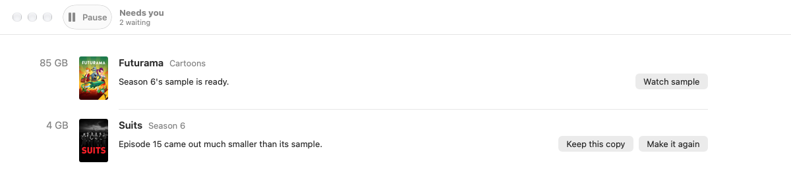
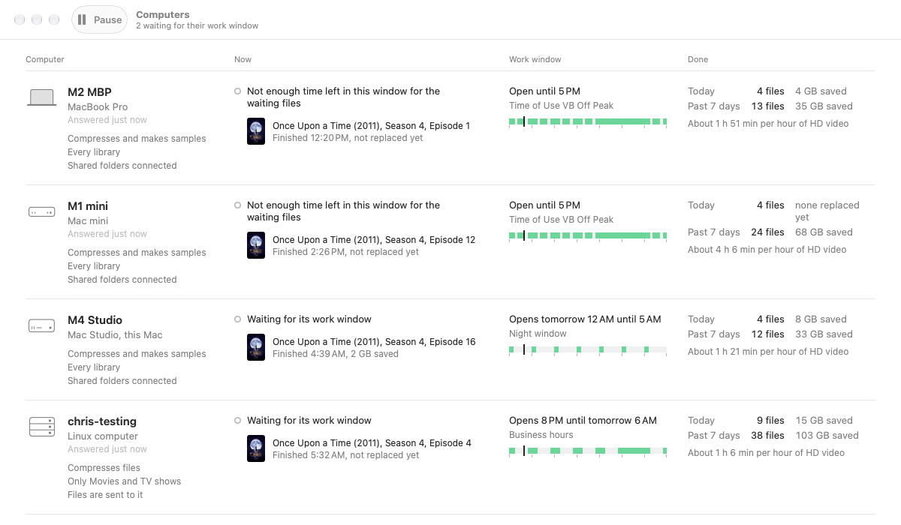

# Mediaforce

Mediaforce is a Mac app that shrinks a media library. In the background it
re-encodes TV shows and movies to AV1 video and Opus audio, checks every new
file's picture and sound against its original, and only then puts it in the
original's place. The original is kept as a rollback copy until you say it
can go.

How much space comes back depends on the source. H.264 episodes have averaged
about 9% of their original size at quality the maintainer was happy with;
some shows need more, and your results will vary.



## What it does

- **Looks.** You decide once how each kind of content should look, by
  watching a short sample side by side with the original. One look covers
  live action, movies included; cartoons are approved one show at a time. Each file is
  then encoded to fit that look and measured before it is published.
- **Checked, one file at a time.** Every episode or movie is encoded, checked
  and published on its own. A problem with one file stays with that file;
  the rest keep going.
- **Rollback copies.** Each replaced original moves to a Cleanup folder.
  Nothing is deleted until you approve it on the Space saved page.
- **Needs you.** Only real judgment calls reach you: a sample to watch, a
  file that came out much smaller than its sample, a computer that needs
  fixing. They appear in one list, with a notification and a Dock
  badge.
- **Other computers.** Extra Macs and Linux computers can share the work
  over SSH. Mediaforce sets up a Mac for you, can wake a sleeping one when
  work is waiting, and sends files to a computer that cannot see your
  library share.
- **Work windows.** Each computer works only in the hours you give it, for
  example overnight or during off-peak power hours, including seasonal
  time-of-use hours that change through the year. A file that cannot finish
  before its window closes waits for the next one.
- **Plain screens.** Library, Activity, Computers and Space saved show what
  is running, what comes next and what has been saved, without encoder
  jargon.



## What you need

- **A Mac running macOS 15 or later.** The app is built for Apple silicon
  and Intel; the maintainer runs it on Apple silicon.
- **Your library** in folders on that Mac's disk or on a network share it
  mounts. Mediaforce reconnects a share in the background using the password
  saved in your Keychain. It also needs a separate working folder, outside the
  library, for new files and the Cleanup folder.
- **ffmpeg** from Homebrew (`brew install ffmpeg-full`) on the Mac that runs
  Mediaforce.
- **At least one computer to do the work**, reached over SSH. That can be
  the same Mac: turn on Remote Login and add it under Settings › Computers.
  - **Another Mac** needs Remote Login turned on. Set up computer installs
    this Mac's SSH key (asking for that account's password once), and
    installs Homebrew's `ffmpeg-full` and `ab-av1` when they are missing.
  - **A Linux computer** needs SSH, ffmpeg with the SVT-AV1 encoder, and
    `ab-av1` already installed. Linux computers compress files but do not make
    samples.
- **Optional:** a Plex server for posters and when each show was added, a
  TMDB read-access token so Mediaforce can tell cartoons from live action and
  which seasons are still airing, and Docker for the sound score on samples.

## Install

### Download

**[Download the latest release](https://github.com/cbusillo/mediaforce/releases/latest)**
(`Mediaforce-<version>.zip`). It is a notarized Mac app with the server built
in, and it updates itself between files from then on.

1. Unzip it and move `Mediaforce.app` to Applications.
2. Make a config file. Start from the app's own defaults and set your library
   folders and working folder in it:

   ```bash
   mkdir -p ~/Library/Application\ Support/mediaforce
   cp /Applications/Mediaforce.app/Contents/Resources/server/app/mediaforce/package_defaults/defaults.toml \
      ~/Library/Application\ Support/mediaforce/config.toml
   open -e ~/Library/Application\ Support/mediaforce/config.toml
   ```

3. Start the background server once. It then starts at login:

   ```bash
   /Applications/Mediaforce.app/Contents/MacOS/mediaforce-server \
     --config ~/Library/Application\ Support/mediaforce/config.toml service enable
   ```

4. Open Mediaforce and finish setup in Settings.

Setup from the app itself, without Terminal, is not built yet.

### From source

This is how to try Mediaforce today. It needs Xcode, [xcodegen](https://github.com/yonaskolb/XcodeGen)
and [uv](https://docs.astral.sh/uv/).

```bash
git clone https://github.com/cbusillo/mediaforce.git
cd mediaforce
uv sync --locked
scripts/mediaforce-dev.sh start backend   # the server, on http://127.0.0.1:8777
scripts/build-mac-app.sh test             # builds the Mac app and runs its tests
open .build/mac-app/Build/Products/Debug/Mediaforce.app
```

Then add your libraries, working folder and computers in Settings. A source
build has limits: macOS sends notifications only for an app signed with a
Developer ID, and the server runs until you stop it
(`scripts/mediaforce-dev.sh stop`) instead of starting at login. For the
signed app that starts at login and updates itself, use the download above.

## Honest limits

- **It is built for one library.** Mediaforce is the maintainer's own tool,
  tuned to the maintainer's taste: about 300 MB for a 45-minute 1080p episode, and 4K
  brought down to 1080p unless a look says to keep it. Change the size goal
  and tallest picture in Settings if you want bigger files.
- **It is early.** Setup needs Terminal, and screens and settings still
  change often.
- **It replaces your files.** Originals are kept until you approve cleanup,
  but keep your own backup too.
- **It does not** compress VR and 3D video yet (those files are listed and
  left alone), give cartoons one shared look (each cartoon show is approved on
  its own), tell animated movies from live action, run on Windows, or
  download, rename or organize media.

## For developers

- [Developer guide](docs/development/developer-guide.md): layout, running
  from source, the command line, configuration, page screenshots and how the
  background work behaves.
- [Docs index](docs/README.md): architecture, design vocabulary, style and
  release flow.
- [DIRECTION.md](DIRECTION.md) and [AGENTS.md](AGENTS.md): what the project
  is for and how agents work in it. The maintainer's
  [overall direction](https://github.com/cbusillo/direction/blob/main/DIRECTION.md)
  comes first.

Mediaforce is released under the [MIT License](LICENSE).
